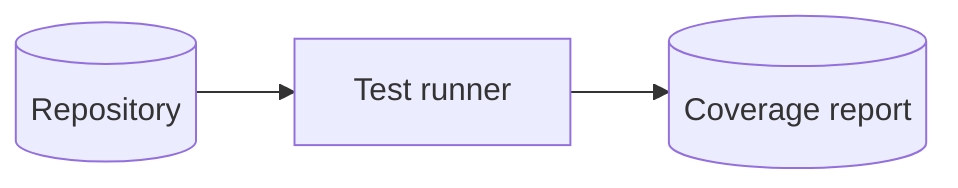
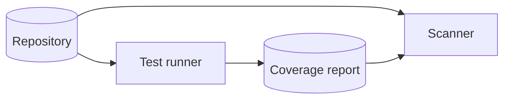
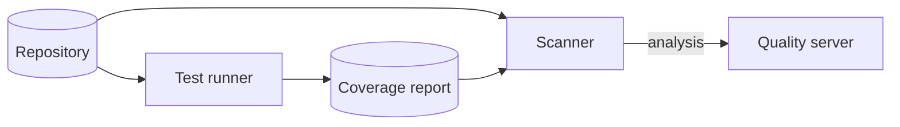
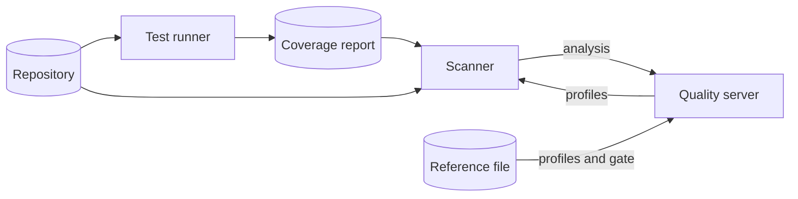
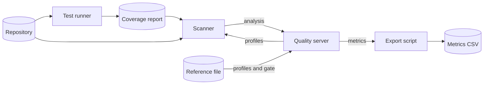
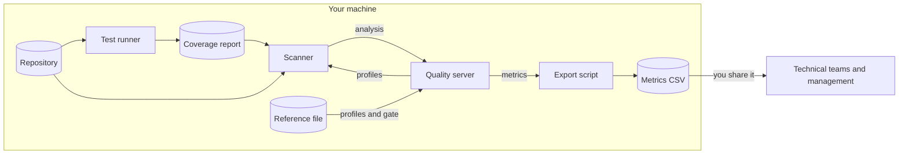

# How it works

`quality.sh` runs the same analysis that a CI quality step runs, but on
your machine. This page explains what each piece does, where your code
goes, and what the numbers in the CSV mean. To run the tool, follow the
[tutorial](../README.md).

## Five pieces run on your machine

### Your tests produce the coverage

The test runner (Vitest) runs your tests. It writes the lines that the
tests executed to a coverage report (`coverage/lcov.info`, in LCOV format).
The quality server (SonarQube) never runs your tests.



The quality server shows only the coverage that this report contains.

### The scanner analyzes the code

The scanner (SonarScanner CLI) is a separate program. `quality.sh scan`
runs it in a container. It reads the code and the coverage report, applies
the rules, and packs the issues and measures into an analysis.



### The quality server stores and computes the results

The scanner sends the analysis to the quality server. The quality server
processes it in the background. It adds up the debt, computes the ratings,
and evaluates the quality gate. `quality.sh scan` waits until that
background task ends.



### The reference file decides the rules

A quality profile lists the rules that the scanner applies. A quality gate
lists the conditions that fail the analysis. A CI server has its own
profiles and gate. `quality.sh reference` writes them from the reference
file (`reference/ci-default.json`) to your local quality server. Before
each analysis, the scanner downloads the project's profiles from the
quality server.

Without the reference file, the local quality server uses the default
rules of its version, and the results do not match CI.



### The export script writes the CSV

The export script (`quality.sh export`) reads the metrics from the Web API
of the quality server. It writes one row per metric to the metrics CSV
(`reports/<key>.csv`).



### Everything stays on your machine

Every piece runs on your machine. The CSV leaves it only when you share
it.



Four settings keep the code on your machine:

- The quality server listens on `127.0.0.1` only. Another computer on the
  network cannot open it.
- `quality.sh up` turns off the telemetry of the quality server, so it
  sends no usage statistics to SonarSource.
- `quality.sh scan` passes the local quality server as `sonar.host.url` on
  the scanner command line. A repository that CI analyzes often names the
  CI server in its `sonar-project.properties`, and the command line
  overrides that file.
- `quality.sh scan` mounts your repository read-only in the scanner
  container. The scanner writes its work files to `.quality/work/<key>/` in
  the quality-tool folder.

## Each number comes from a fixed formula

The examples use the CSV of the [tutorial](../README.md), where the
example app has 56 lines of code.

### Technical debt is a sum of fix times

Every rule has a fixed estimate of the time to fix one issue. Rule
`javascript:S1481` (unused variable) estimates 5 minutes, and rule
`javascript:S1854` (useless assignment) estimates 15 minutes. The example
app has one issue of each, so `sqale_index` is 20 minutes.

The estimate belongs to the rule, not to your code. A one-line fix and a
hard fix of the same rule count the same.

### The debt ratio compares the debt with the size of the code

The quality server estimates that writing one line of code costs 30
minutes. The ratio divides the debt by that cost:

```text
20 / (56 lines x 30 minutes) = 1.19 %
```

The CSV shows `1.2`. The maintainability rating, from A to E, comes from
this ratio.

### Coverage counts lines and conditions together

The quality server mixes covered lines and covered conditions (each side
of an `if`, `&&`, or `? :`) into one number. A real Vite and Vitest
repository had these numbers:

```text
(3388 covered lines + 724 covered conditions) / (3410 lines + 736 conditions) = 99.2 %
```

The line coverage that Vitest reported for the same run was 99.7 %,
because it leaves conditions out. The quality server also counts every
source file, including the files that the Vitest configuration leaves out
of its coverage.

### The quality gate checks new code and all the code

The `CI default` gate has 12 conditions. Six apply to new code. Without a
project version, new code is the code that changed since the first
analysis. The other six conditions apply to all the code.

The example app fails the gate on its first analysis because of one
condition on all the code. The coverage is 12.2 %, and the gate requires
80 %. The conditions on new code have nothing to check yet, because a first
analysis has no new code.

From the second analysis on, the conditions on new code check what
changed. In a test run, we added an unused variable after the first
analysis. The second analysis counted that line as new code. The
maintainability rating on new code became E, and the gate failed on
`new_maintainability_rating`.

## High coverage does not mean the tests catch bugs

A high coverage means that the tests executed those lines. It does not
mean that a test would fail if the logic on those lines broke. The
repository with 99.2 % coverage has a hook that combines eight other
hooks. Its tests replace all eight with mocks and check which arguments the
hook passes to them. A bug in how the real hooks work together still
passes those tests, and the coverage stays the same.

Use the CSV to see the debt grow between analyses. Do not read a green
gate as proof that the tests catch bugs.

## Three settings must match CI

Local results match CI only when these three settings match:

| Setting | Where it is set |
|---|---|
| The SonarQube version | `SONARQUBE_IMAGE`, by default `sonarqube:9.9.8-community` |
| The quality profiles and the quality gate | The reference file, applied with `quality.sh reference` |
| The analysis properties | The `sonar-project.properties` of the repository, plus the `-D` arguments you pass to `scan` |

If the CI server runs a commercial edition, some of its rules do not exist
in the Community Edition, and the results match only in part.
